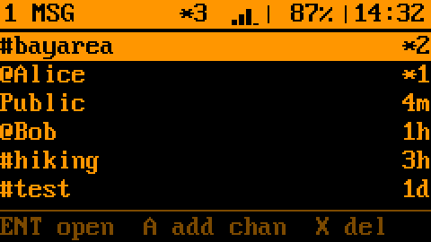
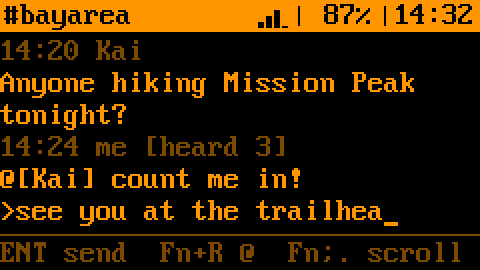
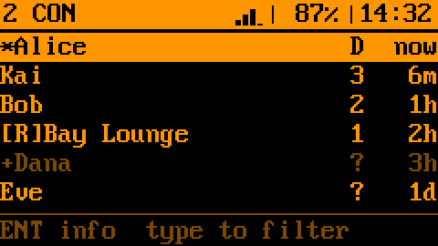
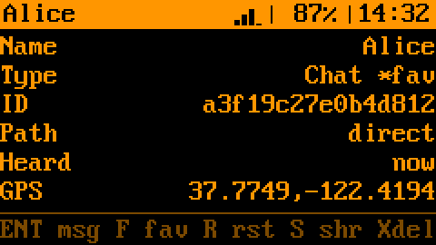
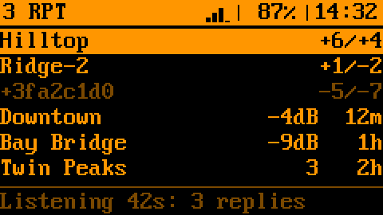
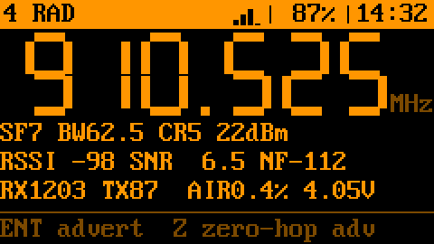
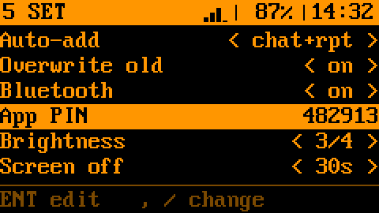
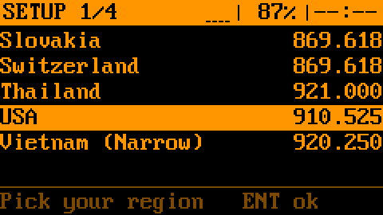

# MeshCore Cardputer

A [MeshCore](https://github.com/meshcore-dev/MeshCore) chat client for the **M5Stack Cardputer-Adv** with the
**Cap LoRa-1262**. Its screen and keyboard work on their own, like a pocket pager for the mesh, and the
**official MeshCore phone app** can pair with it over Bluetooth at the same time.

The mesh runs on MeshCore's own companion engine, so it talks to MeshCore apps, companion radios, Ripple devices
and repeaters.

| | |
|---|---|
|  |  |
| **1 MSG** inbox: channels and DMs, newest first | Channel chat: `[heard 3]` = repeaters re-sent it |
|  |  |
| **2 CON** contacts: favourites, then by activity | Contact details and actions |
|  |  |
| **3 RPT** repeaters: discovery replies, SNR in/out | **4 RAD** radio: frequency, signal, packet counts |
|  |  |
| **5 SET** settings, incl. Bluetooth and app PIN | First-boot setup: pick your region |

## Features

- **Setup without a phone:** region → name → time zone → on air. Nothing is sent before a region is chosen.
- **Messages:** Public, `#hashtag` and private channels, direct messages with delivery marks (`[..]` `[ok]`
  `[x]`) and retries, `@[name]` replies, unread counts, beep.
- **Contacts and repeaters:** auto-added from adverts, favourites, share, filter by typing, repeater discovery
  with SNR both ways. Lists sort by latest activity.
- **Phone app over Bluetooth:** same contacts, channels and radio settings as the keyboard; both work at once.
- **Radio and power:** region presets (868–923 MHz) or manual settings, airtime and noise floor, screen dims and
  sleeps when idle.

## Hardware

[Cardputer-Adv](https://docs.m5stack.com/en/core/Cardputer-Adv) +
[Cap LoRa-1262](https://docs.m5stack.com/en/cap/Cap_LoRa-1262) (868–923 MHz only, so no 433 MHz presets).
Not for the original Cardputer. Attach the antenna before you finish setup; without the Cap the device boots but
shows `RADIO FAIL: check LoRa Cap`.

## Install

- **M5Burner**: search for *Bruce's MeshCore* (Cardputer, Network & Communication), or burn it from the browser
  at https://burner.m5stack.com/U3W4DS.
- **Web installer**: https://zbruceli.github.io/meshcore_cardputer/ in Chrome or Edge.
- **MeshCore web flasher**: https://flasher.meshcore.io → Custom Firmware → the `.bin` from
  [Releases](https://github.com/zbruceli/meshcore_cardputer/releases).
- **esptool**: `esptool.py --chip esp32s3 write_flash 0x0 meshcore-cardputer-vX.Y.Z.bin`

All of them write a merged image at `0x0`, replacing whatever was on the device (including a launcher). Updates
keep your identity, contacts and messages unless you erase. Afterwards switch the Cardputer off and on; the first
boot after a fresh install takes about 25 s while storage is set up.
If the computer doesn't see it: power switch **off**, hold **G0** while plugging in USB, release after 2–3 s.

## Using it

| Key | Action |
|---|---|
| `Tab`, `1`–`5` | Switch tabs (`Fn`+digit while typing) |
| `;` `.` `,` `/` | Up, down, left, right (`Fn` while typing) |
| `Enter` / `` ` `` / `Del` | Select or send / back / delete |
| G0 button | Send an advert (announce yourself) |

- **Chat:** just type; `Enter` sends. `Fn+R` in a channel starts a reply to the latest sender.
- **1 MSG:** `A` add a channel (`#name`, or a name then its key), `X` twice to leave or delete.
- **2 CON:** type to filter. In a contact: `Enter` message, `F` favourite, `R` reset path, `S` share, `X` delete.
- **3 RPT:** `D` asks nearby repeaters to reply (60 s).
- **4 RAD:** `Enter` flood advert, `Z` zero-hop advert.
- **5 SET:** `,` `/` change, `Enter` edit. Factory reset needs `Enter` twice.

**Phone app:** in the MeshCore app, connect to `MeshCore-<your name>` and enter the **App PIN** from 5 SET (new
each boot). Messages you send from one side don't show in the other's history; incoming ones show on both.

Tips: press G0 once after setup so others can add you. A channel message stuck at `[sent]` wasn't heard
re-sent by any repeater. Change the time zone in SET when daylight saving changes.

## Build from source

```bash
git clone https://github.com/zbruceli/meshcore_cardputer.git && cd meshcore_cardputer
pio run -t upload        # PlatformIO; then power-cycle the Cardputer
```

Docs: [PRD.md](PRD.md) (scope) · [roadmap_plan.md](roadmap_plan.md) (status) · [CLAUDE.md](CLAUDE.md) (code,
hardware, rules). Screenshots: `python3 scripts/render_screens.py`.

Built on [MeshCore](https://github.com/meshcore-dev/MeshCore) and [M5Cardputer](https://github.com/m5stack/M5Cardputer);
pins from [MeshCore-Cardputer-ADV](https://github.com/Stachugit/MeshCore-Cardputer-ADV). License: [MIT](LICENSE).
