# MeshCore Cardputer

A [MeshCore](https://github.com/meshcore-dev/MeshCore) chat client for the **M5Stack Cardputer-Adv** with the
**Cap LoRa-1262**. Its screen and keyboard work on their own, like a pocket pager for the mesh, and the
**official MeshCore phone app** can pair with it over Bluetooth at the same time.

The mesh runs on MeshCore's own companion engine, so it talks to MeshCore apps, companion radios, Ripple devices
and repeaters.

| | |
|---|---|
|  |  |
| **1 MSG** inbox: channels and DMs, newest first | Channel chat: `[heard 3]` = 3 repeaters re-sent it |
| 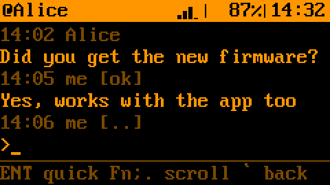 |  |
| DM: `[ok]` delivered, `[..]` waiting | Quick replies: `Enter` on an empty line |
|  |  |
| **2 CON** contacts: favourites, then by activity | Contact details: path, distance and direction |
|  | 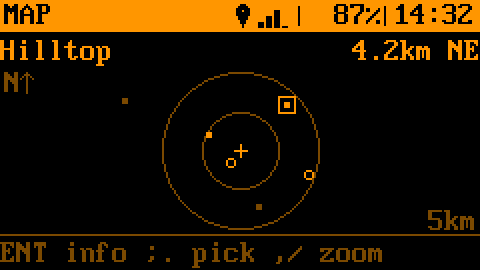 |
| **3 RPT** repeaters: discovery replies, SNR in/out | **3 RPT** > `M`: contacts with a location around you |
| 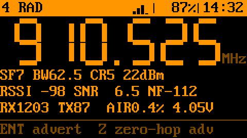 | 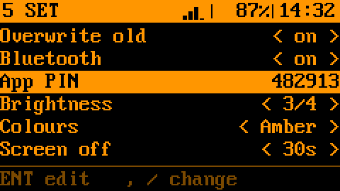 |
| **4 RAD** radio: frequency, signal, packet counts | **5 SET** settings, incl. Bluetooth and app PIN |
| 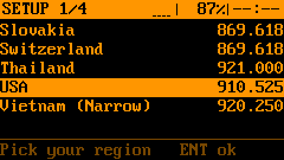 | 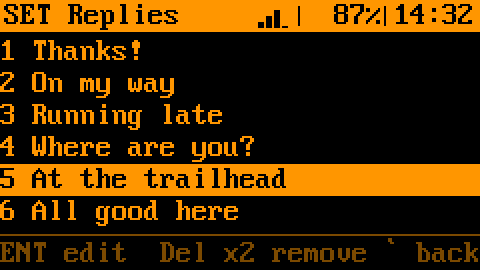 |
| First-boot setup: pick your region | SET > **Quick replies** |
| 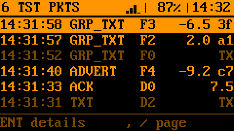 | 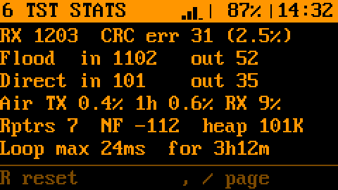 |
| **6 TST** (optional): live packet log | **6 TST**: counters, CRC errors, airtime |
| 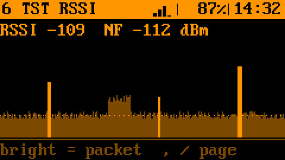 | 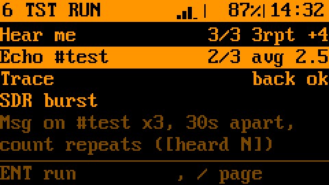 |
| **6 TST**: live RSSI graph, packets bright | **6 TST**: tests that transmit |
| 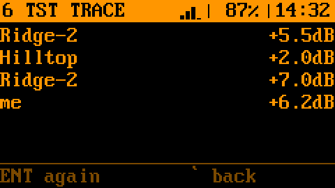 | 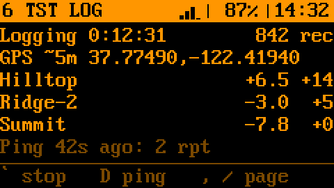 |
| **6 TST**: trace, SNR at every hop there and back | **6 TST**: wardrive logger to the SD card |

## Features

- **Setup without a phone:** region → name → time zone → on air. Nothing is sent before a region is chosen.
- **Messages:** Public, `#hashtag` and private channels, direct messages with delivery marks and retries,
  `@[name]` replies, quick replies, your location as a `geo:` link, unread counts, beep.
- **Contacts and repeaters:** auto-added from adverts, favourites, share, filter by typing, repeater discovery
  with SNR both ways, a map of everyone with a known location. Lists sort by latest activity.
- **Phone app over Bluetooth:** same contacts, channels and radio settings as the keyboard; both work at once.
- **GPS:** sets the clock, keeps your position, distance and direction to contacts. It runs only for short fixes
  and sleeps otherwise. The phone app's GPS switch works too.
- **Field tools** (optional test tab): packet log, signal graph, tests (do repeaters hear me, trace a path), and a
  wardrive logger that maps which repeaters you hear where, to an SD card.
- **Power:** the screen dims and sleeps when idle; hold G0 to power off; battery warnings, and it switches itself
  off when the battery is empty.
- **Colour schemes:** amber (default), green phosphor, VFD cyan, red, blue LCD, classic LCD and paper.


## Hardware

[Cardputer-Adv](https://docs.m5stack.com/en/core/Cardputer-Adv) +
[Cap LoRa-1262](https://docs.m5stack.com/en/cap/Cap_LoRa-1262) (868–923 MHz only, so no 433 MHz presets; its GPS
is used too). Not for the original Cardputer. Attach the antenna before you finish setup; without the Cap the
device boots but shows `RADIO FAIL: check LoRa Cap`. An SD card (FAT32) is needed only for the wardrive logger.

## Install

- **M5Burner**: search for *Bruce's MeshCore* (Cardputer, Network & Communication), or burn it from the browser
  at https://burner.m5stack.com/U3W4DS.
- **Web installer**: https://zbruceli.github.io/meshcore_cardputer/ in Chrome or Edge.
- **MeshCore web flasher**: https://flasher.meshcore.io → Custom Firmware → the `.bin` from
  [Releases](https://github.com/zbruceli/meshcore_cardputer/releases).
- **esptool**: `esptool.py --chip esp32s3 write_flash 0x0 meshcore-cardputer-vX.Y.Z.bin`

Each replaces whatever was on the device (including a launcher). The first boot after a fresh install takes about
25 s while storage is set up. If the computer doesn't see the Cardputer: power switch **off**, hold **G0** while
plugging in USB, release after 2–3 s; after flashing, switch it off and on.

**Updating** keeps your identity, contacts, channels, messages and settings (unless you erase). The web installer
also keeps the phone pairing. After an update with M5Burner or esptool, pair the phone app again: forget
`MeshCore-<name>` in the phone's Bluetooth settings, then connect with the PIN from 5 SET.

## Using it

| Key | Action |
|---|---|
| `Tab`, `1`–`5` | Switch tabs (`6` if the test tab is on; `Fn`+digit while typing) |
| `;` `.` `,` `/` | Up, down, left, right (`Fn` while typing) |
| `Enter` / `` ` `` / `Del` | Select or send / back / delete |
| G0 button | Press: send an advert (announce yourself). Hold 3 s: power off; press again to turn on |

The status bar shows the screen, unread messages (`*3`), the signal of the last packet, battery and clock. The
screen dims at half the **Screen off** time and goes dark after it; the key that wakes it does nothing else.
Destructive actions (delete, leave, factory reset) need their key pressed twice.

- **Chat:** just type; `Enter` sends. `Fn+;` `Fn+.` scroll the history. In a channel, `Fn+R` starts an `@[name]`
  reply to the latest sender (again for the one before). DMs show `[..]` waiting, `[ok]` delivered, `[x]` failed
  after 3 tries; channel messages show `[heard N]` when repeaters re-send them.
- **Quick replies:** `Enter` on an empty line lists them; `1`–`8` (or `;` `.` and `Enter`) puts one in the
  compose line, `Enter` sends it. `0` **My location** adds a `geo:` link with your GPS position (it waits for a
  fix if the last one is old; `` ` `` cancels). Edit them in SET > **Quick replies** (`Enter` edit or add, `Del`
  twice remove).
- **1 MSG:** `Enter` opens. `A` adds a channel (`#name`, or a name then its key), `X` twice leaves or deletes.
- **2 CON:** type to filter, `` ` `` clears. In a contact: `Enter` message, `F` favourite, `R` reset path, `S`
  share (zero-hop advert), `X` twice delete. Contacts with a location show distance and direction.
- **3 RPT:** `D` asks nearby repeaters to reply (60 s; SNR shown as how you hear them / how they hear you).
  `+` = heard, not yet a contact (`Enter` adds it). `M` opens the map: contacts with a location around you,
  north up; squares are repeaters, rings are others, bright = heard in the last day, off-scale ones sit on the
  edge. `;` `.` pick nearer/farther (name, distance and direction on top), `,` `/` zoom out/in (500 m–200 km),
  `Enter` opens the contact.
- **4 RAD:** `Enter` flood advert, `Z` zero-hop advert (only direct neighbours hear it).
- **5 SET:** `;` `.` move, `,` `/` change, `Enter` edit. Radio (region, or frequency, bandwidth, SF, coding rate,
  TX power, path hash), auto-add and overwrite-oldest, Bluetooth and **App PIN**, brightness, **Colours**, screen
  off, beep, quick replies, test tab, time zone, clock, GPS, my location, location in adverts, my ID, firmware
  version, factory reset (`Enter` twice).
  - **GPS** `off` / `clock` (sets the clock every 6 h) / `location` (also a fresh position every 10 min, used as
    your node's location). **My location**: `Enter` gets a fresh fix in any mode. **Loc in adverts** shares your
    position with the mesh (off by default; same setting as the phone app).
- **6 TST** (turn on with **Test tab** in SET): `,` `/` switch pages.
  - **Packets:** the last 32 in and out; `Enter` shows path, sender and the repeater you heard.
  - **Stats:** counters, CRC errors, airtime, noise floor, free memory; `R` resets.
  - **RSSI:** live signal graph (24 s), packets bright.
  - **Run:** tests that transmit, kept few and spaced out; `Enter` starts, `` ` `` stops. **Hear me**: 3 discovery
    rounds, 30 s apart, how many repeaters reply and how well they hear you. **Echo #test**: 3 messages on `#test`
    (join it first), repeats per message. **Trace**: pick a repeater with a known path; SNR at every hop there and
    back. **SDR burst**: 10 zero-hop adverts, 5 s apart, for `scripts/sdr_burst.py`.
  - **Log:** the wardrive logger, below.

**Wardrive logger** (6 TST, last page): logs which repeaters you hear where, to an SD card (FAT32; cards over
32 GB usually come as exFAT and need formatting as FAT32 on a computer). Insert the card, `Enter` starts (it
checks the card first), `` ` `` stops and saves. The GPS stays on while logging (~6 h of battery with the screen
off). Listen-only by default: every packet that came through a repeater counts for that repeater (best SNR per
30 s or 25 m). `D` adds a ping: a zero-hop discovery at most once a minute, after moving 100 m, to learn how well
repeaters hear you. The screen shows the fix and the best repeaters of the last minute with SNR and margin (how
far above what your SF can still decode). Files: `meshcore/wd-<date>-<time>.csv`, written every 30 s. On a
computer, `python3 scripts/wardrive_kml.py wd-*.csv` makes a map for Google Earth (dots coloured by SNR, lines to
repeaters with a known location).

**Phone app:** in the MeshCore app, connect to `MeshCore-<your name>` and enter the **App PIN** from 5 SET (new
each boot unless you set one in the app). Messages you send from one side don't show in the other's history;
incoming ones show on both.

Tips: press G0 once after setup so others can add you. A channel message stuck at `[sent]` wasn't heard re-sent
by any repeater. Indoors, repeaters often can't hear you: try a window or outdoors. Change the time zone in SET
when daylight saving changes.

## Build from source

```bash
git clone https://github.com/zbruceli/meshcore_cardputer.git && cd meshcore_cardputer
pio run -t upload        # PlatformIO; then power-cycle the Cardputer
```

Docs: [PRD.md](PRD.md) (scope) · [roadmap_plan.md](roadmap_plan.md) (status, priorities) ·
[CLAUDE.md](CLAUDE.md) (code, hardware, rules). Screenshots: `python3 scripts/render_screens.py`.

Built on [MeshCore](https://github.com/meshcore-dev/MeshCore) and [M5Cardputer](https://github.com/m5stack/M5Cardputer);
pins from [MeshCore-Cardputer-ADV](https://github.com/Stachugit/MeshCore-Cardputer-ADV). License: [MIT](LICENSE).
